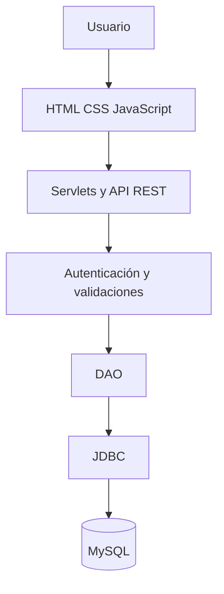
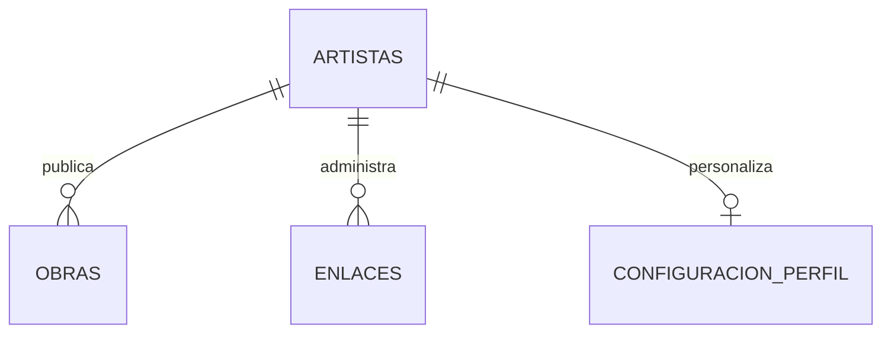

# ✳ Artfolio

### A little corner of the internet for creative souls.


## ♡ About Artfolio

Artfolio es una plataforma web artística diseñada para que
creadores digitales puedan construir su identidad visual,
personalizar su portafolio, publicar obras y compartir sus
enlaces creativos desde un mismo espacio.

El proyecto combina una identidad visual retro kawaii con
una arquitectura web basada en Java, Jakarta EE y MySQL.

Artfolio surge como proyecto académico para el caso de estudio
Estudio Creativo Aurora, con la intención de evolucionar
hacia una plataforma artística de uso real.

## ✿ Funcionalidades

### Área pública

- Página principal dinámica.
- Directorio de artistas.
- Perfiles artísticos personalizados.
- Galería pública de obras.
- Filtros por categorías.
- Página de enlaces tipo Linktree.
- Opciones para compartir perfiles y enlaces.
- Diseño adaptable a dispositivos móviles.

### Área privada

- Registro de artistas.
- Inicio y cierre de sesión.
- Panel administrativo.
- Editor visual con vista previa.
- Personalización de avatar, colores y biografía.
- Creación, edición y eliminación de obras.
- Publicación de obras y gestión de borradores.
- Administración y ordenamiento de enlaces.
- Personalización de la página de enlaces.
- Persistencia de información mediante MySQL.

## 🎨 Categorías artísticas

| Categoría | Contenido |
|---|---|
| Ilustraciones | Arte e ilustración digital |
| Fotografía | Proyectos fotográficos |
| Diseño digital | Composiciones y proyectos digitales |
| Animación | Proyectos animados |
| Diseño gráfico | Comunicación visual y diseño |

## ✳ Stack tecnológico

| Tecnología | Versión / función |
|---|---|
| Apache NetBeans | 31 |
| Java | 25 |
| Jakarta EE | 11 |
| GlassFish | 8 |
| Maven | Gestión y compilación |
| MySQL | 8 |
| HTML5 | Estructura |
| CSS3 | Diseño visual |
| JavaScript | Interactividad |
| JDBC | Conexión con MySQL |
| REST | Servicios web |
| Git | Control de versiones |
| GitHub | Repositorio remoto |

## ♡ Arquitectura

Artfolio utiliza una arquitectura por capas que separa
la interfaz, la lógica de aplicación y la persistencia.



## ✿ Estructura del proyecto

```text
Artfolio/
├── pom.xml
├── src/
│   └── main/
│       ├── java/
│       │   └── com/artfolio/
│       │       ├── config/
│       │       ├── dao/
│       │       ├── filter/
│       │       ├── resources/
│       │       ├── security/
│       │       └── servlet/
│       └── webapp/
│           ├── css/
│           ├── js/
│           ├── WEB-INF/
│           │   └── views/
│           │       └── admin/
│           ├── index.html
│           ├── artista.html
│           ├── enlaces.html
│           ├── login.html
│           └── registro.html
└── README.md
```

## 🌷 Base de datos

Nombre de la base de datos:

`artfoliio_db`

### Tablas principales

| Tabla | Función |
|---|---|
| artistas | Cuentas y perfiles artísticos |
| obras | Obras y proyectos |
| enlaces | Enlaces personalizados |
| configuracion_perfil | Personalización visual |



## 🔒 Seguridad

- Autenticación mediante sesiones.
- Almacenamiento de contraseñas mediante hashes.
- Protección de rutas administrativas.
- Validación de formularios.
- Consultas parametrizadas mediante JDBC.
- Protección CSRF en operaciones privadas.
- Validación de propiedad de obras y enlaces.
- Separación entre información pública y privada.
- Credenciales de MySQL mediante variables de entorno.

## ☀️ Instalación y ejecución local

### Requisitos

- JDK 25.
- Apache NetBeans 31.
- GlassFish 8.
- MySQL Server 8.
- Maven.
- Git.

### 1. Obtener el proyecto

```bash
git clone https://github.com/AndreaAN3/Artfolio.git
```

### 2. Configurar MySQL

Crear la base de datos:

```sql
CREATE DATABASE IF NOT EXISTS artfoliio_db
CHARACTER SET utf8mb4
COLLATE utf8mb4_unicode_ci;
```

Importar el esquema SQL correspondiente a las cuatro
tablas del proyecto.

### 3. Configurar las credenciales

En Windows PowerShell:

```powershell
[Environment]::SetEnvironmentVariable(
    "ARTFOLIO_DB_PASSWORD",
    "TU_CONTRASEÑA_MYSQL",
    "User"
)
```

Reiniciar NetBeans y GlassFish después de configurar
la variable de entorno.

La configuración local utiliza el usuario MySQL root.
Para producción se recomienda un usuario dedicado con
privilegios limitados y una conexión segura.

### 4. Abrir el proyecto

Abrir Artfolio desde Apache NetBeans.

Seleccionar GlassFish 8 como servidor de aplicaciones.

Ejecutar Clean and Build y posteriormente Run Project.

### 5. Acceder a Artfolio

http://localhost:8080/Artfolio/

## ✳ API

### Servicios públicos

| Método | Endpoint |
|---|---|
| GET | /api/publico/artistas |
| GET | /api/publico/perfil?id=1 |
| GET | /api/publico/enlaces?id=1 |
| GET | /resources/obras |
| GET | /resources/obras?artistaId=1 |

### Servicios privados

| Métodos | Endpoint |
|---|---|
| GET, PUT | /api/privado/perfil |
| GET, POST, PUT, DELETE | /api/privado/obras |
| GET, POST, PUT, DELETE | /api/privado/enlaces |
| GET, PUT, DELETE | /api/privado/configuracion |

Los servicios privados requieren una sesión autenticada.
Las operaciones de modificación requieren protección CSRF.

## 🎀 Identidad visual

- Estética retro kawaii.
- Dirección visual playful hybrid.
- Colores pastel personalizables.
- Stickers y elementos decorativos.
- Microinteracciones.
- Tipografía expresiva.
- Diseño responsive.

## ♡ Gestión del proyecto

El desarrollo se organiza en cuatro fases:

1. Inicio.
2. Planteamiento.
3. Ejecución.
4. Cierre.

Se utiliza Git y GitHub para el seguimiento de cambios,
administración de tareas y publicación de versiones.

## ✿ Versiones

### v1.0.0

Primera versión funcional de Artfolio para ejecución local.

Incluye los módulos principales de autenticación,
personalización, administración, publicación de obras
y persistencia de información.

## 🌱 Mejoras futuras

- Despliegue en un servidor público.
- Carga directa de imágenes y archivos multimedia.
- Dominios personalizados.
- Estadísticas de visitas.
- Mayor variedad de temas visuales.
- Ampliación de las pruebas automatizadas.

## ☀️ Autora

**a sunny**

Proyecto académico y plataforma artística personal.

---

Made with ♡ for creative souls.

**Artfolio © 2026**
